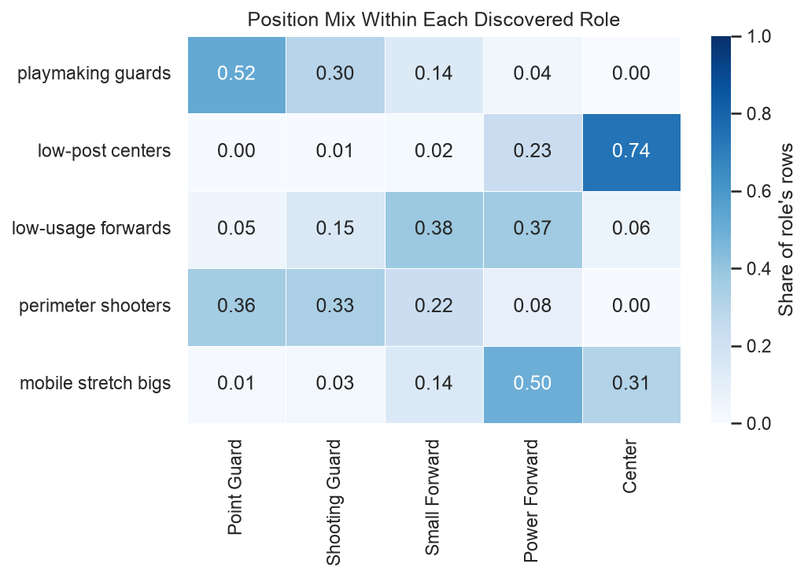

# Discovering EuroLeague Player Roles with Unsupervised Learning

**Doron and Yuval**: an academic data science project.

**Start here:**
- [Rendered report (HTML)](outputs/EuroLeague_Player_Roles_Project.html). Download it and open it in a browser, because GitHub shows only the HTML source.
- [Main notebook](notebooks/EuroLeague_Player_Roles_Project.ipynb), which has the full analysis with saved outputs.

## Research question

Can unsupervised learning find meaningful EuroLeague player roles in performance data? And do those roles distinguish players in ways the traditional basketball positions do not?

A position label such as "Power Forward" says little about how a player actually plays. We clustered player-season-team observations by their statistical profiles alone. Position labels were never used as clustering inputs; we brought them in only afterwards, to interpret the roles we found.

## Key findings

- **Five interpretable roles.** A full-covariance Gaussian mixture model (GMM) found five components in 4,568 player-season-team observations from 19 EuroLeague seasons (E2007–E2025). We named them from their feature profiles:

  | Role | Observations | Main profile |
  |---|---:|---|
  | Playmaking guards | 1,054 | High assists and turnovers; shorter; little rebounding |
  | Low-post centers | 756 | Almost no three-point attempts; very narrow shot locations; tallest; most rebounds and blocks |
  | Low-usage forwards | 976 | Flattest profile; few turnovers and fouls drawn |
  | Perimeter shooters | 1,162 | Longest shot distance; most three-point attempts; fewest two-point attempts |
  | Mobile stretch bigs | 620 | Tall, with high rebounding and blocks, but wider shot locations and some three-point shooting |

- **Distinctions beyond positions.**
  - Centers divided between two roles: 69% were low-post centers and 24% were mobile stretch bigs.
  - Point Guards and Shooting Guards split between the same two roles in reversed proportions. Point Guards were 54% playmaking guards and 40% perimeter shooters; Shooting Guards were 36% and 44%.
  - Two roles each combined two positions:
    - Low-usage forwards were 38% Small Forwards and 37% Power Forwards.
    - Mobile stretch bigs were 50% Power Forwards and 31% Centers.
- **Limited agreement with positions.** The adjusted Rand index (ARI) between the roles and the five positions was 0.210. A low ARI alone does not show that the roles are better than positions. Together with the cross-tabulations above, it shows that the roles and the positions divide players differently.



## Why a five-component GMM

- **Baseline.** K-Means, with k = 2–12, served as the baseline. Silhouette scores were low at every k (0.299 at k = 2, falling to 0.081 at k = 12). This, along with the PCA projection, showed overlapping groups along a continuum rather than well-separated clusters. Membership probabilities from a GMM suit that kind of structure better than hard assignments.
- **Covariance collapse.** With the default covariance regularization, the BIC appeared to favour k = 10. That solution included collapsed components built on legitimate point masses, such as the 443 rows with no three-point attempts and the 865 rows with no blocks. These are artifacts of the Gaussian likelihood, not extra roles.
- **Selected model.** With `reg_covar = 0.01` and with `0.1`, nothing collapsed, and the BIC was lowest at k = 5 under both settings. Under `0.01`, the five-component model had the lowest BIC (155,866). k = 6 was a close second (ΔBIC = 23), and k = 4 was well behind (ΔBIC = 884). We report the k = 5 choice as conditional on this regularization.

## Robustness

- **Random initializations.** We refitted the model with ten random states. The mean pairwise ARI was 0.978 (minimum 0.929), and at least 96.8% of observations kept their component after label matching.
- **Stricter sample.** We repeated the full pipeline on a stricter participation threshold: at least 10 games and 200 minutes, which left 3,679 rows. The BIC again chose k = 5. On the shared rows, the ARI with the main model was 0.887, with 94.9% matched agreement.

## Limitations

- **No ground truth.** There is no independent ground truth for player roles. The analysis shows that the roles are interpretable and differ from positions. It does not show that they are more *accurate* than positions.
- **Analysis choices.** The participation threshold (5 games and 100 minutes), the 17-feature representation, the shrinkage of shooting percentages and the choice of k all shape the result.
- **Shot data.** Shot-coordinate units are undocumented, and we could not establish that coordinates were recorded consistently across all seasons. The A–J zone labels change meaning after E2008, so we excluded them.
- **Overlapping roles.** 3.5% of observations have a maximum membership probability below 0.6.
- **Repeated players.** The same player appears once per season and team, so role sizes count observations, not distinct players.
- **Position labels.** The labels are imperfect references. Where both sources gave a position, 365scores and Wikipedia disagreed for 383 of 1,141 players. Each player has one label for all seasons, and 2.2% of eligible observations have no five-category label.

## Data and provenance

| File | Origin | In repository |
|---|---|---|
| `data/raw/euroleague_players.csv` | [EuroLeague & EuroCup Datasets (Kaggle)](https://www.kaggle.com/datasets/babissamothrakis/euroleague-datasets): season totals per player-season-team | Yes |
| `data/raw/euroleague_points.csv` | Same Kaggle dataset: shot events with coordinates | **No** (over GitHub's 100 MB file limit) |
| `data/raw/players_bio.csv` | Retrieved by the authors from the EuroLeague API: height and three-category position | Yes |
| `data/processed/height_overrides.csv` | Heights we verified by hand for players recorded with a missing or zero height. The sources for the zero-height cases are in `zero_height_player_research.csv`. | Yes |
| `data/processed/player_positions_365scores.csv` | Five-category positions collected from 365scores by web scraping. The collection script is not in this repository. | Yes |
| `data/processed/wikipedia_position_lookup/wikipedia_position_lookup.csv` | Wikipedia positions, built by `scripts/wikipedia_position_lookup.py` | Yes |
| `data/processed/player_season_team_features_with_position.csv` | Output of the main notebook: the full feature table with position labels (not the scaled modeling matrix) | Yes |

**Data rights.** We have not verified the licensing or redistribution terms of the data in this repository:
- the Kaggle dataset and the EuroLeague API data it was compiled from;
- `players_bio.csv`;
- the 365scores positions. These were scraped, and the 365scores terms of use may restrict reuse.

Wikipedia text is available under CC BY-SA. The lookup table keeps the source URL for each player. Third-party data in this repository is included only to document how the analysis was done; anyone reusing it should check the original terms. The repository has no code license.

## Reproducing the analysis

The notebook **cannot be run from a fresh clone alone**, because `data/raw/euroleague_points.csv` is not in the repository. To reproduce it:

1. Download `euroleague_points.csv` from the [Kaggle dataset](https://www.kaggle.com/datasets/babissamothrakis/euroleague-datasets) and place it in `data/raw/`. We have not checked that the current Kaggle version is byte-identical to the file we used, so row counts may differ if the dataset has been updated.
2. Install the dependencies (we developed the project with Python 3.14):
   ```bash
   pip install -r requirements.txt
   ```
3. From the repository root, run the notebook top to bottom:
   ```bash
   python -m nbconvert --to notebook --execute --inplace notebooks/EuroLeague_Player_Roles_Project.ipynb
   ```
   The run rewrites `data/processed/player_season_team_features_with_position.csv`. Expect last-digit floating-point differences in the three `*_std` shot-location columns. The GMM sweeps take about a minute. Random seeds are fixed (`RANDOM_STATE = 42`).

The position-enrichment files are committed, so a rerun does not query 365scores or Wikipedia.

## Repository structure

```text
├── notebooks/
│   ├── EuroLeague_Player_Roles_Project.ipynb   # Final analysis (start here)
│   ├── 01_data_audit.ipynb                     # Supporting data audit
│   ├── 02_coordinate_system_analysis.ipynb     # Supporting shot-coordinate analysis
│   └── archive/
│       └── EuroLeague_Unsupervised_Roles.ipynb # Early feasibility notebook (superseded)
├── outputs/
│   ├── EuroLeague_Player_Roles_Project.html    # Rendered final report
│   ├── figures/                                # Figure exports (main and supporting notebooks)
│   └── tables/                                 # Supporting audit and position-provenance tables
├── data/raw/                                   # Source data (never modified)
├── data/processed/                             # Derived and enrichment data
├── scripts/wikipedia_position_lookup.py
├── RESEARCH_ROADMAP.md                         # Research stages, decisions and evidence
├── CLAUDE.md                                   # Maintenance notes for AI-assisted editing
└── requirements.txt
```

The notebook and its HTML rendering are the authoritative results. The files in `outputs/figures/` and `outputs/tables/` were exported at earlier points:
- `01_data_audit.ipynb` writes most of the audit tables and the missing-value and height figures;
- `02_coordinate_system_analysis.ipynb` writes the `coordinates/` subfolders;
- the remaining figures are higher-resolution copies of figures in the main notebook;
- `player_season_team_feature_dictionary.csv` documents every column of the processed feature table.

The two supporting notebooks also read `data/processed/merged_euroleague_players.csv`, which is not in the repository (it exceeds the file limit).

## Authorship and AI assistance

Doron and Yuval designed and carried out this research. They chose the research question and made the methodological decisions: the participation threshold, the features, the preprocessing, the model and its regularization, and the number of components. They also interpreted the results and wrote the conclusions.

AI-assisted tools, mainly Claude Code, helped with implementation, debugging, documentation and editorial review of the notebook text. The authors reviewed this work and are responsible for the final content.
